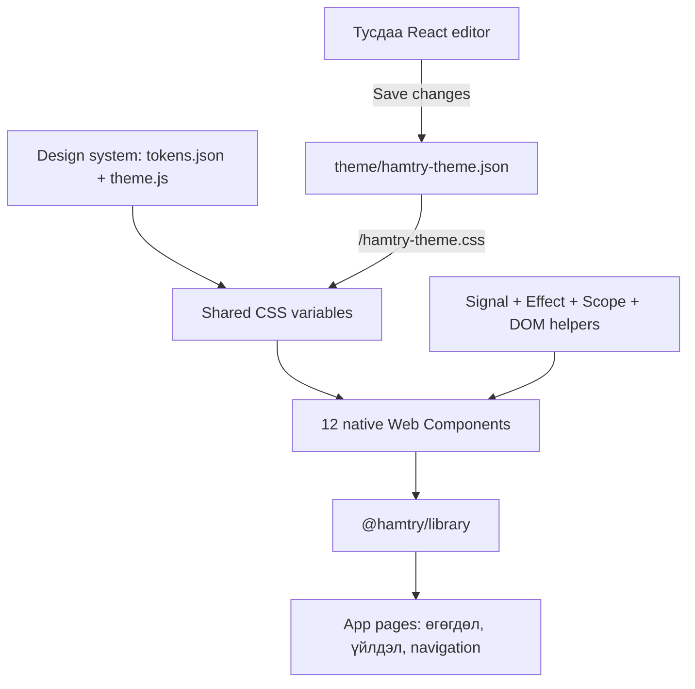

# Архитектур: сан ба хуудасны ялгаа

**Хуудас сангаа импортолж хэрэглэнэ. Сан нь дизайн системийн токеноор
дүрслэлээ шийдэж, өөрийн framework-ээр төлөв ба lifecycle-аа удирдана.**

## Дөрвөн үндсэн давхарга

| Давхарга | Хариуцах зүйл | Кодын байрлал |
| --- | --- | --- |
| Framework | Төлөв, өөрчлөлт дагах, DOM helper, нөөц цэвэрлэх | `Front-End/client/src/library/core/` |
| Design system | Өнгө, typography, spacing, radius, responsive утга | `Front-End/client/src/library/design-system/` |
| Components | Товч, талбар, tab, card-ийн DOM ба зан төлөв | `Front-End/client/src/library/components/` |
| Public library | Дээрх боломжуудыг нэг import-оор гаргах | `Front-End/client/src/library/index.js` |

Одоогийн туршилтын хуудас `src/app/main.js` дотор байна. Энэ хуудас сангаас
импортлоод ямар текст, зураг, жишээ өгөгдөл үзүүлэхээ шийддэг.

## Сан өөрөө юу хийхгүй вэ?

Компонентын сан нь зарын API, хэрэглэгчийн session, navigation, төлбөрийн
логик мэдэхгүй. Жишээ нь card зүрхээ өөрчилж `hamtry-save` event гаргана.
Хуудас тэр event-ийг сонсоод backend-д хадгалах хүсэлт хийх эсэхээ шийднэ.
Одоогийн demo-ийн зүрх нь local төлөв бөгөөд backend хадгалалт биш.

`@hamtry/library` нь энэ checkout-ийн Vite alias ба jsconfig editor mapping.
Өөр repository-д `npm install @hamtry/library` гэж одоохондоо суулгах боломж
үүсгээгүй; package distribution тусдаа дараагийн ажил байна.

## Нэг өөрчлөлтийн зам

1. Хэрэглэгч товч дарна.
2. Listener `setCount(previous => previous + 1)` дуудна.
3. Signal шинэ утгаа шууд хадгална.
4. Түүнийг уншсан effect дараагийн microtask-д нэгтгэгдэн ажиллана.
5. `bindText()` зөвхөн шаардлагатай DOM node-ийн текстийг өөрчилнө.

Virtual DOM эсвэл компонент бүхэлдээ дахин render хийх систем байхгүй.
Browser native DOM дээр шаардлагатай өөрчлөлтийг хийнэ.

## Shadow DOM хаана байна вэ?

Сангийн 12 компонент `HamtryElement`-ээс удамшиж тус бүр shadow root үүсгэнэ.
Туршилтын хуудасны контейнер, React editor-ийн page DOM нь энгийн light DOM.
Ингэснээр page layout ердийн CSS-ээр, компонентын доторх layout өөрийн CSS-ээр
удирдагдана. Shadow DOM нь style тусгаарлалт болохоос нууцлалын хамгаалалт биш.

## Theme ба editor

Хуудас анхны токенуудаа `applyDefaultTheme()`-ээр авна.
`/hamtry-theme.js` module хадгалсан CSS-ийг хоёр секунд тутам шалгаж шинэчилнэ.
Editor дээрх draft бусад хуудаст хүрэхгүй; зөвхөн **Save changes** дарахад
server дээр хадгална. Design system ба компонентын сан хоёр editor-оос React
код импортлох шаардлагагүй.
