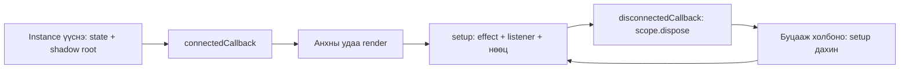

# Class, instance, Shadow DOM хэрхэн ажилладаг вэ?

## Class нь загвар, instance нь бодит компонент

`HamtryButton` class нь товч хэрхэн ажиллахыг тодорхойлсон загвар.
Хуудасны хоёр `<hamtry-button>` нь уг class-ийн хоёр тусдаа instance болно.
`this` нь яг одоо ажиллаж байгаа нэг instance-ийг заана.

```js
class MyCounter extends HamtryElement {
  state = useState(0)
}
```

Энэ class-аас үүссэн instance бүр `useState(0)`-ийг тусдаа дуудна. Тиймээс
тоо нь хоорондоо холилдохгүй. Хэрэв state-ийг class-ийн гадна module дээр
үүсгэвэл instance-ууд зориудаар нэг төлөв хуваалцаж болно.

| Үг | Энэ кодод юу гэсэн утгатай вэ? |
| --- | --- |
| `extends HamtryElement` | Манай суурь class-ийн shadow root, lifecycle, cleanup-ийг өвлөнө |
| `this.root` | Тухайн instance-ийн Shadow DOM |
| `state` | Instance-ийн өөрийн төлөвийг хадгалах JavaScript field |
| `render()` | Удамшсан class хэрэгжүүлдэг DOM үүсгэх арга |
| `static observedAttributes` | Browser ямар HTML attribute-ийн өөрчлөлт мэдэгдэхийг заана |
| `get value()` / `set value()` | `field.value` унших/бичихэд ажиллах public property |

Бид энгийн JavaScript class хэрэглэнэ. `state`, `root`, `scope` зэрэг field нь
техникийн хувьд харагдана; page нь баримтжуулсан public property/event-ийг
хэрэглэнэ. Shadow DOM-ийн `open`/`closed` нь field-ийн хандалтын дүрэм биш.

## Browser class-ийг tag-тай холбоно

```js
customElements.define('my-counter', MyCounter)
```

Дараа нь `<my-counter></my-counter>` бичихэд browser уг class-ийн instance
үүсгэнэ. Custom tag-ийн нэр зураастай байна. Бэлэн `hamtry-*` tag-уудыг
`registerComponents()` бүртгэдэг; дахин өөр class-аар overwrite хийхгүй.

Constructor гараар бичвэл эхэнд `super()` дуудна. Манай жишээнд constructor
шаардлагагүй: class-ийн field initializer төлөвөө үүсгэж, суурь class нь
`attachShadow({ mode: 'open', delegatesFocus: true })` дууддаг.

## Lifecycle-ийн дараалал



- `render()` тухайн instance-д нэг удаа ажиллаж тогтвортой DOM үүсгэнэ.
- `setup()` холбогдох бүрд reactive binding болон event listener бүртгэнэ.
- Салгах үед scope cleanup ажиллаж listener, effect, timer-ийг цэвэрлэнэ.
- Буцааж холбоход DOM ба state хадгалагдаж, `setup()` шинээр ажиллана.

`connectedCallback()` болон `disconnectedCallback()`-ийг browser өөрөө дуудна.
Хэрэглэгчийн код эдгээрийг гараар дуудахгүй. State өөрчлөгдөхөд `render()`
дахин дуудахгүй; effect одоо байгаа DOM-оо шинэчилнэ.

## Ажиллах жижиг class

Доорх кодыг Vite-ээр ачаалагдах `src` module-д байрлуулна.

```js
import {
  HamtryElement, useState, bindText, required, listen,
  registerComponents, applyDefaultTheme, applyComponentStyles,
} from '@hamtry/library'

applyDefaultTheme()
registerComponents()

class LessonCounter extends HamtryElement {
  // Instance бүр өөрийн тоотой.
  state = useState(0)

  render() {
    applyComponentStyles(this.root)
    // Зөвхөн бидний бичсэн тогтмол HTML. Гаднын өгөгдөл энд залгахгүй.
    this.root.innerHTML = `
      <hamtry-button aria-label="Тоо нэмэх">+</hamtry-button>
      <output aria-live="polite"></output>
    `
  }

  setup() {
    const [count, setCount] = this.state
    const output = required('output', this.root)
    const button = required('hamtry-button', this.root)

    // count() өөрчлөгдөхөд зөвхөн output-ийн текст шинэчлэгдэнэ.
    bindText(output, count)
    // Салгах үед энэ listener scope-тойгоо автоматаар устна.
    listen(button, 'click', () => setCount(previous => previous + 1))
  }
}

if (!customElements.get('lesson-counter')) {
  customElements.define('lesson-counter', LessonCounter)
}
```

```html
<lesson-counter></lesson-counter>
<lesson-counter></lesson-counter>
```

## Shadow DOM, slot, part

Host нь `<hamtry-button>`, түүний shadow дотор native `<button>` байна.
Page-ийн `button { ... }` selector shadow доторх button-д шууд үйлчлэхгүй.
Харин CSS custom property, тухайлбал `--brand-primary`, host-оос дотогш
удамшина. Тиймээс shared theme нь shadow компонентуудын өнгийг өөрчилж чадна.

`<hamtry-button>Хадгалах</hamtry-button>` доторх текст `<slot>` дээр харагдана.
Slot нь page-ийн өгсөн хүүхэд агуулгыг shadow layout-д байрлуулдаг.
`hamtry-select` нь онцгой: option-уудыг native shadow select рүү хуулдаг.

Компонентын `part` бол гаднаас зориудаар style хийхэд нээсэн цэг. Жишээ нь
`hamtry-button::part(button)` selector ашиглаж болно. Гэхдээ shared өнгө,
spacing-аа эхлээд design token-оор удирдах нь зөв.

DevTools-д `element.shadowRoot` нээж шалгаж болно. Page өөр компонентын доторх
class нэрэнд найдахаас илүү public property болон event-ийг хэрэглэнэ.

## Түгээмэл алдаа

`listen(button, 'click', this.render())` нь render-ийг шууд дуудна. Callback
өгөхдөө `() => this.someMethod()` гэж бичвэл зөв цагт ажиллаж, `this` instance
хэвээр үлдэнэ. State-ийг `setup()` дотор дахин үүсгэвэл reconnect үед анхны
утга руу буцна. State-аа class field дээр үүсгэж, binding-аа `setup()` дотор
бүртгэнэ.
